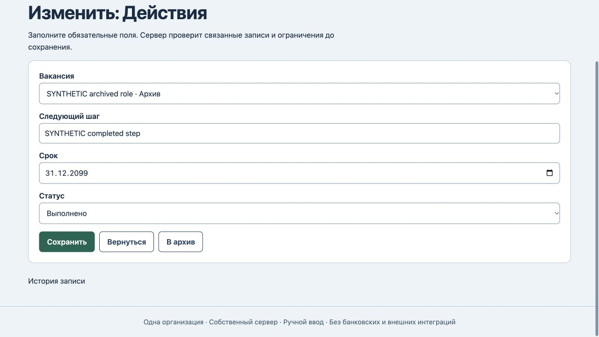
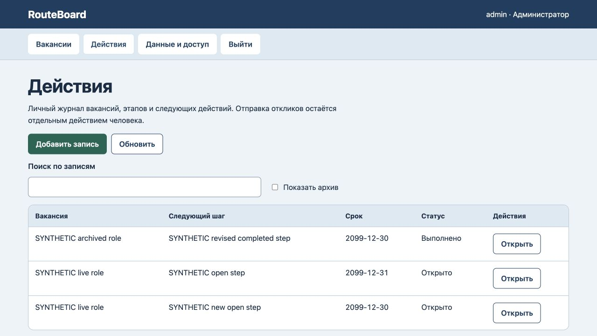

# RouteBoard: редактирование завершённого действия

25 октября2026. Редактор прежнего завершённого действия терял выбранную архивную вакансию. Обязательное поле становилось пустым,браузер не давал сохранить правку. Сервер уже сохранял завершённую историю и запрещал новые/повторно открытые/перенесённые open-действия по архивной вакансии. Два добавленных контроля прошли ещё на baseline — это прежние ограничения,не новые серверные исправления.

Исправлен только список формы:текущая архивная вакансия остаётся выбранной с пометкой «Архив». Другие архивные вакансии не предлагаются;в новой форме доступны действующие. Правила сервера и схема данных не менялись.

Все6 тестов прошли,включая файловый перезапуск/восстановление.4 авторизованных HTTP400 отказа и браузерный отказ повторного открытия сохранили все данные/версию8/журнал8. Текст и срок завершённого действия сохранены с исходной вакансией и done;новое открытое действие создано по действующей вакансии. Reload:3 действия,все вакансии и прежнее открытое действие неизменны,версия10/журнал10. [Машинная проверка](history-verification.json).

Работающий сервер отдаёт точный новый app.js без перезапуска;18 сохранённых состояний/версий/журналов не изменились. Статусы отмечаются вручную и не доказывают отправку отклика,собеседование или трудоустройство. Автоматических откликов,агрегатора вакансий,клиентской изоляции и промышленного размещения нет. Новый полный аудит интерфейса/безопасности не проводился.
